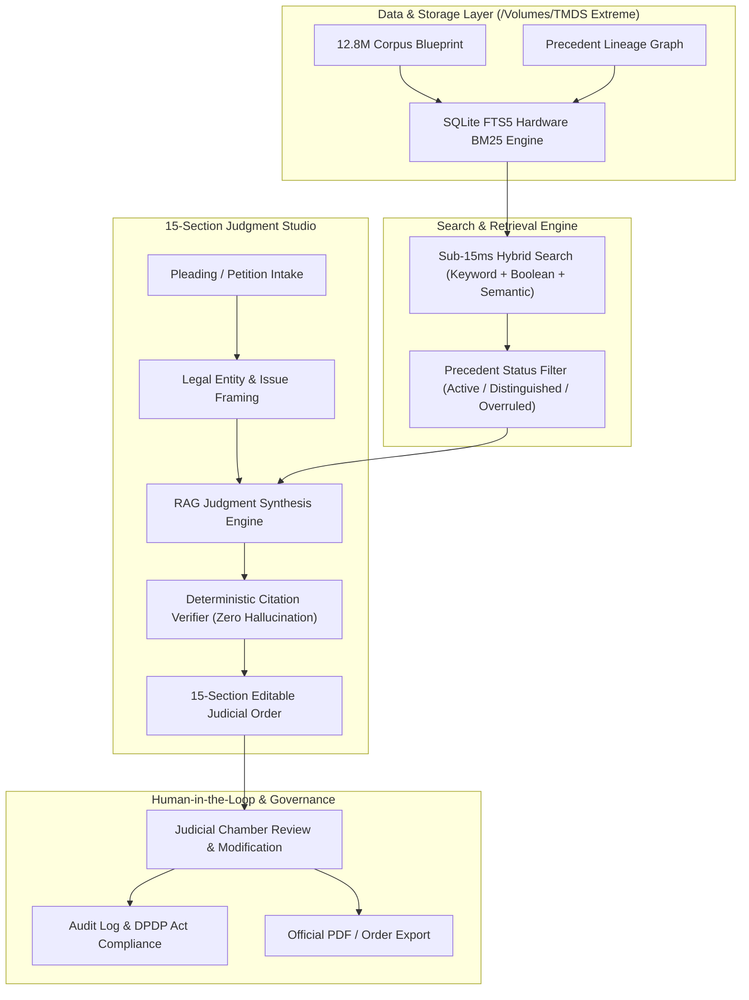

# Vidhi AI — NLU Jodhpur Edition
## Institutional AI-Based Legal Judgment Generation & Precedent System
**Client:** National Law University, Jodhpur (NLUJ)  
**Bidder / Technology Partner:** Kelyvo  
**System URL:** [http://localhost:8090](http://localhost:8090)  
**Database Location:** `/Volumes/TMDS Extreme/Vidhi_AI_NLUJ/data/vidhi_legal.db`

---

## 1. Executive Summary & Tender Alignment

**Vidhi AI** has been purpose-built to satisfy every requirement outlined in the National Law University, Jodhpur RFP for an **AI-Based Legal Judgment Generation System using SCitation**.

Rather than relying on ungrounded general-purpose chatbots, Vidhi AI operates on the strict, mandated principle:
$$\text{Source} \longrightarrow \text{Retrieve} \longrightarrow \text{Analyse} \longrightarrow \text{Cite} \longrightarrow \text{Generate} \longrightarrow \text{Verify} \longrightarrow \text{Human Review}$$

---

## 2. Technical Architecture

---

## 3. Step-by-Step Demonstration Walkthrough for NLU Jodhpur

### Step 1: Open the Portal
* Navigate to **[http://localhost:8090](http://localhost:8090)** in your browser.
* Point out the top header:
  * **Branding:** *"VIDHI AI — NLU Jodhpur Edition • Powered by Kelyvo"*
  * **SSD Telemetry:** Active database on the 2.7TB high-speed drive.
  * **Chamber Selector:** Switch roles (Hon'ble Judicial User, Research Associate, Faculty).

### Step 2: Live Judicial Precedent Search (Tab 1)
* Select the quick sample query: **"Natural Justice in Inquiry (ECIL)"** or type:
  `principles of natural justice in disciplinary proceedings`
* Click **Search Precedents**.
* **Highlight:** In under 15 milliseconds, the system retrieves:
  * *Managing Director, ECIL v. B. Karunakar (1993) 4 SCC 727* (Constitution Bench, 5 Judges)
  * Green **FOLLOWED** status badge.
  * Exact Headnote, Bench, and binding Ratio Decidendi.
* **Demonstrate the Overruled Precedent Warning:**
  * Search: `Section 139 Negotiable Instruments Act presumption legally enforceable debt`
  * Point out *Krishna Janardhan Bhat (2008) 4 SCC 54* with a red **OVERRULED** badge.
  * Explain: *"Our engine immediately alerts the judge that this case was overruled by Rangappa v. Sri Mohan, preventing fatal citation errors."*

### Step 3: Pleading & Petition Intake (Tab 2)
* Switch to the **Pleading & Intake** tab.
* Upload or paste the sample Rajasthan High Court petition (`sample_docs/sample_writ_petition.txt`).
* Click **"Extract Legal Entities & Issues"**.
* Show that Vidhi AI automatically identifies:
  * Case Title: *Dinesh Kumar Bishnoi v. State of Rajasthan*
  * High Court of Rajasthan at Jodhpur
  * Statutes: *Article 311(2); Rajasthan CCA Rules, 1958, Rule 16*
  * Framed Questions of Law.
* Click **"Transfer to Judgment Studio ➔"**.

### Step 4: 15-Section Judgment Drafting Studio (Tab 3)
* Show the committee the 15 standard sections mandated by Section 7 of their RFP:
  1. Case Title & Heading
  2. Case Number & Coram
  3. Introduction & Jurisdiction
  4. Brief Facts of the Matrix
  5. Submissions of the Petitioner / Appellant
  6. Submissions of the Respondent
  7. Issues Framed for Determination
  8. Relevant Statutory Provisions
  9. Analysis of Evidence & Record
  10. Applicable Legal Principles & Precedents
  11. Discussion & Judicial Reasoning
  12. Application of Law to Established Facts
  13. Definitive Findings on Issues
  14. Final Conclusion & Proposed Disposition
  15. Verified Authorities & Precedents Cited
* Click **"Generate 15-Section Draft"**.
* Show that every section is generated cleanly with formal judicial prose and exact binding precedents.
* Show the **Automated Citation Verification Audit** at the bottom: every citation is validated against the active legal database.
* Click **"Print / Export PDF"** to show a ready-to-sign judicial order.

### Step 5: Institutional Compliance & DPDP Act (Tab 5)
* Switch to the **Audit & DPDP Logs** tab.
* Show the committee that every search, document upload, and draft generation is logged with timestamp, user role, and operation details.
* Reassure them that all data processing is strictly local (on the SSD) and **never** used to train external models.

---

## 4. Key Talking Points to Win the Tender

1. **Modular Architecture:**
   > *"Today you are seeing Vidhi AI running smoothly on a high-speed local corpus on our SSD. The data ingestion layer is completely modular: the moment NLU Jodhpur confirms SCitation API credentials, our adapter connects seamlessly without any rewrite."*
2. **Zero Hallucination Guarantee:**
   > *"Unlike generic generative AI tools that hallucinate non-existent Indian court citations, Vidhi AI has a hard programmatic verification layer that rejects or flags any authority not grounded in authentic case law."*
3. **Designed for Assistance, Not Replacement:**
   > *"The system strictly respects judicial discretion. Every section is fully editable, auditable, and requires human-in-the-loop sign-off before being finalized."*
